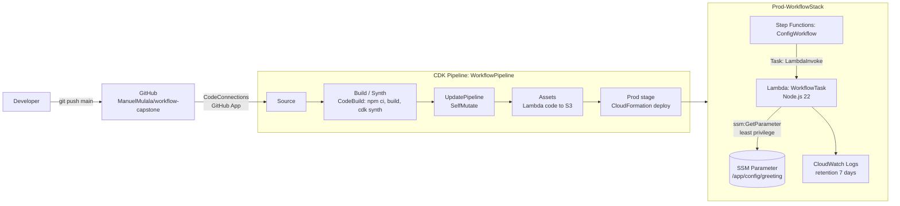
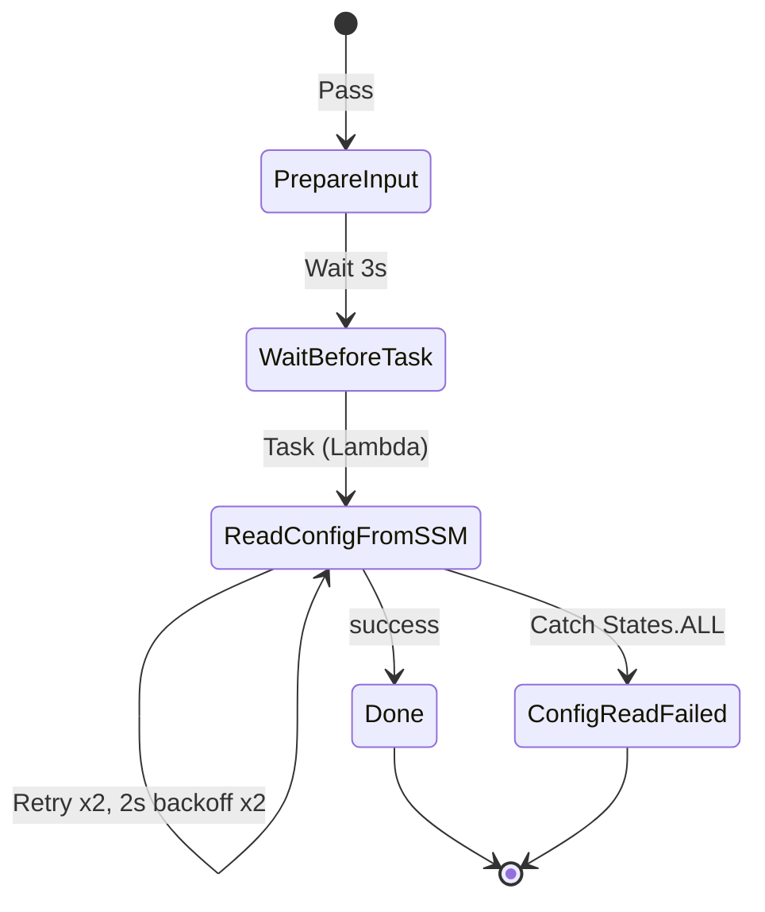
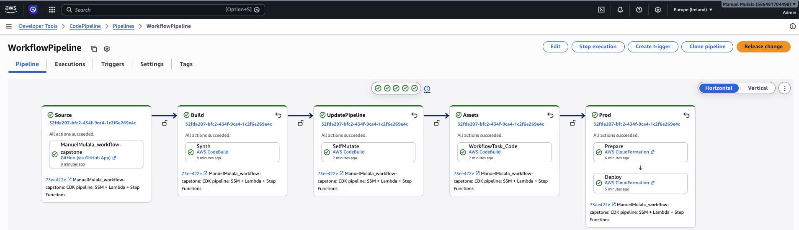
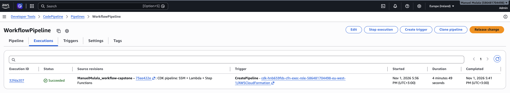
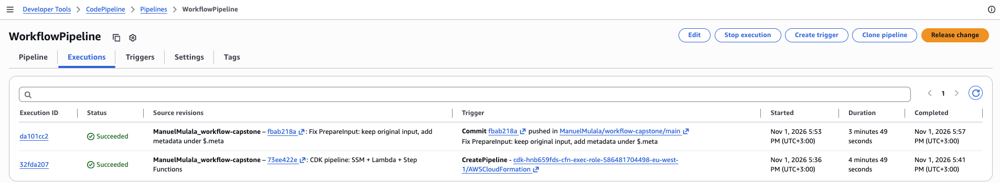
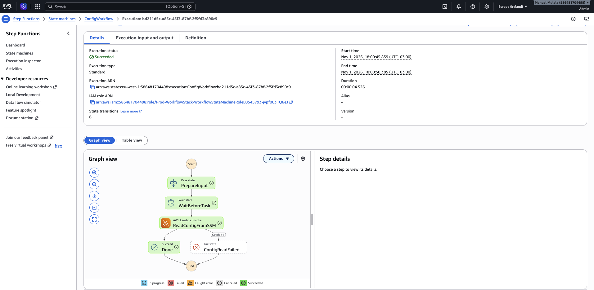
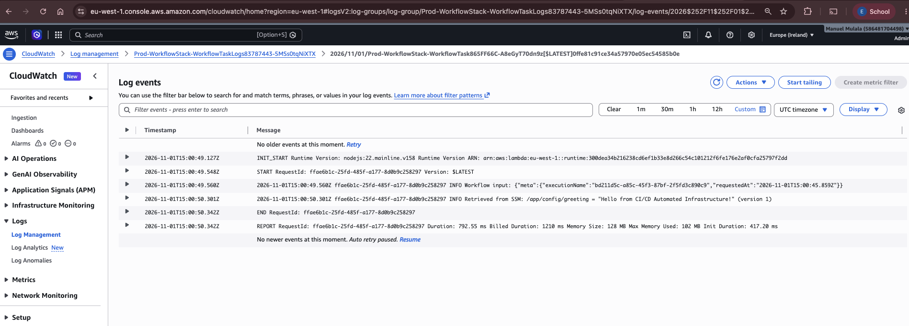

# Capstone 4: Automated Serverless Workflow with CDK Pipelines, Step Functions, Lambda and SSM

Infrastructure as code with **AWS CDK (TypeScript)**. A **CDK Pipeline** (CodePipeline + CodeBuild) deploys the stack on every push to `main`. The stack runs a **Step Functions** workflow whose **Lambda** task reads its configuration at runtime from **SSM Parameter Store**.

- **Account / region:** 586481704498 / eu-west-1 (Ireland)
- **Pipeline:** `WorkflowPipeline` | **Deployed stack:** `Prod-WorkflowStack` | **State machine:** `ConfigWorkflow`
- **SSM parameter:** `/app/config/greeting`

---

## 1. Architecture



### State machine



| State | Type | Purpose |
|---|---|---|
| `PrepareInput` | Pass | Adds `requestedAt` and `executionName` under `$.meta` and keeps the original input intact |
| `WaitBeforeTask` | Wait | Pauses 3 seconds (simulates a scheduled step) |
| `ReadConfigFromSSM` | Task | Invokes the Lambda that reads `/app/config/greeting` |
| `Done` | Succeed | Normal end |
| `ConfigReadFailed` | Fail | Reached through Catch if the Lambda still fails after retries |

**Error handling:** `ReadConfigFromSSM` retries on any error (`States.ALL`) up to 2 times, starting at 2s with backoff rate 2. If it still fails, a Catch writes the error to `$.error` and moves to the `ConfigReadFailed` Fail state, so the execution ends with a clear error name and cause.

---

## 2. Repository layout

```
bin/workflow-capstone.ts   CDK app entry point: creates WorkflowPipelineStack (eu-west-1)
lib/pipeline-stack.ts      CDK Pipeline: GitHub source, synth step, Prod stage
lib/workflow-stage.ts      Deployable stage that wraps the application stack
lib/workflow-stack.ts      SSM parameter, Lambda, IAM grant, log group, state machine
lambda/index.js            Lambda handler: reads the SSM parameter with AWS SDK v3
cdk.json                   CDK config, including connectionArn and repo context
docs/screenshots/          Evidence
```

The state machine is defined in CDK (`lib/workflow-stack.ts`). The generated ASL JSON can be viewed in the console under `ConfigWorkflow` → Definition, or in `cdk.out/` after `npx cdk synth`.

---

## 3. Design decisions

| Decision | Reason |
|---|---|
| Modular CDK: pipeline stack, stage, application stack | The pipeline and the workload are separate. The stage can be added again for another environment or account without changing the workload code. |
| Parameter name passed to Lambda as `PARAM_NAME` env var | No hardcoded config in the function. CDK supplies the name from the parameter it created. |
| `greeting.grantRead(fn)` | Least privilege. The Lambda role can only read this one parameter (`ssm:GetParameter*`, `ssm:DescribeParameters` scoped to its ARN). |
| AWS SDK v3 (`@aws-sdk/client-ssm`) on Node.js 22 | SDK v2 (`aws-sdk`) in the PDF skeleton is not included in Node 18+ Lambda runtimes. v3 is built in, so no bundling is needed. |
| `DefinitionBody.fromChainable` | The `definition` property in the skeleton is deprecated. |
| Self-mutating pipeline | Changes to the pipeline itself are applied by the pipeline (UpdatePipeline stage), so only the first deploy is manual. |
| Explicit log group, 7-day retention, destroyed with the stack | Keeps cost and clutter down and makes the log group a known stack output. |
| `simulateFailure` input flag in the Lambda | Lets the Retry/Catch path be demonstrated on demand without breaking the deployment. |

---

## 4. Setup (from scratch)

**Prerequisites:** Node.js 20+, AWS CLI v2 with admin credentials, a GitHub connection in eu-west-1 with status **Available** and the AWS Connector GitHub app allowed on this repo.

```bash
git clone git@github.com:ManuelMulala/workflow-capstone.git && cd workflow-capstone
npm ci
# set your connection ARN in cdk.json -> context.connectionArn
npx cdk bootstrap aws://586481704498/eu-west-1      # once per account/region
npx cdk deploy WorkflowPipelineStack                  # the only manual deploy
```

After this, every push to `main` runs: **Source → Build (Synth) → UpdatePipeline → Assets → Prod**.

---

## 5. Running the workflow

```bash
SM_ARN=arn:aws:states:eu-west-1:586481704498:stateMachine:ConfigWorkflow

# Happy path
aws stepfunctions start-execution --region eu-west-1 --state-machine-arn $SM_ARN --input '{}'

# Error-handling path: Lambda throws, Step Functions retries, then Catch -> ConfigReadFailed
aws stepfunctions start-execution --region eu-west-1 --state-machine-arn $SM_ARN --input '{"simulateFailure": true}'

# Lambda logs
LG=$(aws cloudformation describe-stacks --region eu-west-1 --stack-name Prod-WorkflowStack \
  --query "Stacks[0].Outputs[?OutputKey=='LambdaLogGroup'].OutputValue" --output text)
aws logs tail "$LG" --region eu-west-1 --since 30m
```

### Observed result (1 Nov 2026)

Successful execution `bd211d5c-…`: **Succeeded in 4.5 s, 6 state transitions**. Output:

```json
{
  "status": "Success",
  "parameter": "/app/config/greeting",
  "greeting": "Hello from CI/CD Automated Infrastructure!",
  "parameterVersion": 1,
  "requestedAt": "2026-11-01T15:00:45.859Z",
  "executionName": "bd211d5c-a85c-45f3-87bf-2f5fd3c890c9"
}
```

Lambda log line:

```
INFO Retrieved from SSM: /app/config/greeting = "Hello from CI/CD Automated Infrastructure!" (version 1)
```

---

## 6. CI/CD evidence

| Pipeline run | Commit | Result |
|---|---|---|
| 1 | `73ee422` CDK pipeline: SSM + Lambda + Step Functions | Succeeded (initial deploy, 4m 49s) |
| 2 | `fbab218` Fix PrepareInput: keep original input, add metadata under `$.meta` | Succeeded, **triggered automatically by the push** |
| 3 | `c8f45ac` Fix LambdaLogGroup output; add evidence screenshots | Triggered automatically by the push |

Runs 2 and 3 show that a commit to `main` deploys infrastructure changes with no manual step.

---

## 7. Screenshots

### Successful CDK Pipeline execution (build and deploy stages)



### Pipeline triggered automatically by a commit


### Successful Step Functions execution (graph view)


### Lambda CloudWatch Logs: value retrieved from SSM Parameter Store


---

## 8. Lessons learned

1. **Intrinsic functions fail on missing JSONPath fields.** The first execution failed in 48 ms in `PrepareInput` with `States.Runtime: The JsonPath argument for the field '$.simulateFailure' could not be found in the input '{}'`. Fix: the Pass state now writes only metadata to `$.meta` (`resultPath`) and passes the original input through, so optional fields never need to exist.
2. **Custom log groups get generated names.** Assigning a `logs.LogGroup` to the function means logs are not in `/aws/lambda/<function>`. The stack output now returns `logGroup.logGroupName` instead of a guessed path.
3. **The PDF skeleton needs updating.** `aws-sdk` v2 is not available in current Node runtimes, `NODEJS_18_X` is deprecated, and `definition` is a deprecated CDK property.
4. **CDK's default `.gitignore` ignores `*.js`.** Without `!lambda/*.js`, the Lambda source would never reach GitHub and the pipeline build would deploy an empty function.
5. **Check which git repository and identity you are using.** `cdk init` skipped creating a repository because the folder sat inside a git repo in the home directory, and HTTPS pushes used a different saved GitHub account. Running `git init` in the project and pushing over SSH as the repo owner fixed both.
6. **Only the first deploy is manual.** After `cdk deploy WorkflowPipelineStack`, the pipeline updates itself and the application on every push.

---

## 9. Cleanup

```bash
aws cloudformation delete-stack --region eu-west-1 --stack-name Prod-WorkflowStack
aws cloudformation wait stack-delete-complete --region eu-west-1 --stack-name Prod-WorkflowStack
npx cdk destroy WorkflowPipelineStack
```

The `CDKToolkit` bootstrap stack (staging S3 bucket and roles) can stay for future CDK projects. It costs almost nothing.
